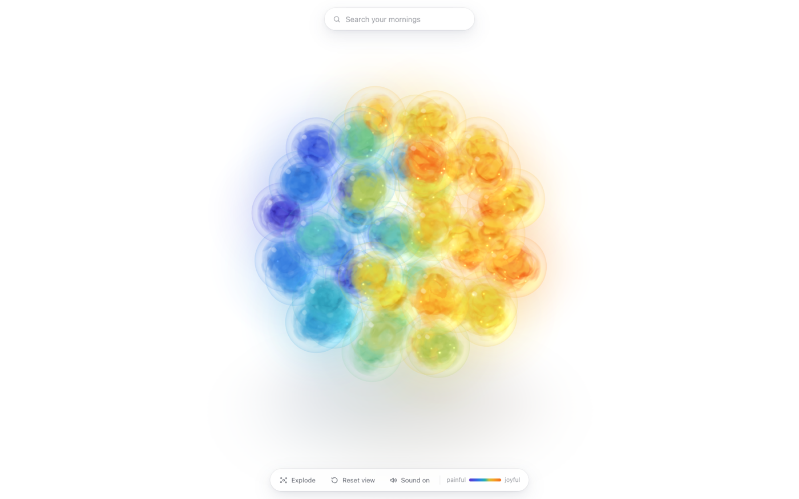
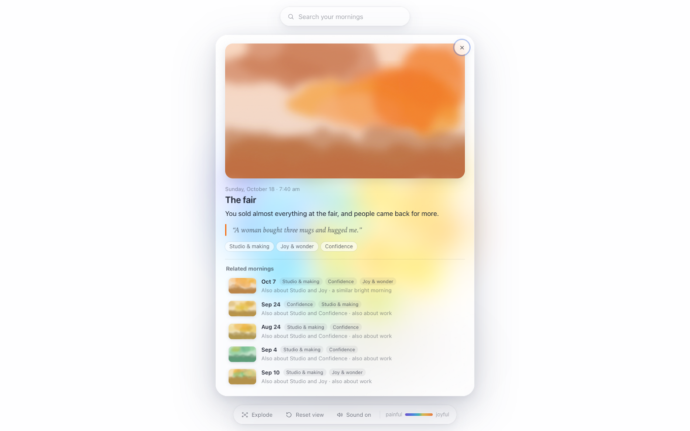

# Mood Orbs

**A season of mornings, as a ball of glowing glass.**

Each orb is one morning of journal writing. Its color shows how the morning felt. Inside each orb is a small, slowly moving world shaped by what was written that day. Mornings that felt alike sit close together.



> **The mornings here are made up.** They tell the story of a pretend person who spends one autumn turning a garage into a pottery studio, worrying about money, saying goodbye to a friend, and getting ready for a craft fair. They're here so you can see how it works. You can swap in your own mornings (see [Make it yours](#make-it-yours)).

---

## Contents

- [The idea](#the-idea)
- [How to open it](#how-to-open-it)
- [How to use it](#how-to-use-it)
- [How to read an orb](#how-to-read-an-orb)
- [Is it safe to open?](#is-it-safe-to-open)
- [Make it yours](#make-it-yours)
- [What's in the folder](#whats-in-the-folder)
- [Thanks and license](#thanks-and-license)

---

## The idea

It started with an old note about words as points on a map: what if every piece of writing had a *place*, and writing that meant similar things sat near each other?

Most maps of meaning are made by computers, and their directions don't mean anything a person would name. Here, the directions are chosen by hand, and they're plain ones you'd ask yourself about any morning:

| Measure | From | To |
|---|---|---|
| **Mood** | painful | joyful |
| **Time** | looking ahead (plans, hopes) | looking back (reflecting, finished) |
| **Life** | personal (family, inner life) | work (making, building) |

Each morning gets a number on each of these three measures, plus one more for **intensity**: how strongly it was felt. Those four numbers place the orb, color it, and grow the little world inside it.

The result is a way to look back on a stretch of your life all at once. You can spot the hard weeks, the bright ones, and the mornings that echo each other weeks apart.

---

## How to open it

Nothing to install. It's a web page that opens in your browser.

1. At the top of this page on GitHub, click the green **Code** button.
2. Click **Download ZIP**.
3. Find the file in your Downloads folder and unzip it:
   - **Mac:** double-click the ZIP file.
   - **Windows:** right-click the ZIP file and choose **Extract All**.
4. Open the new **mood-orbs-main** folder and double-click **`mood-orbs.html`**.

It opens in your web browser. You need to be **online** while it loads, because it fetches one free 3D drawing tool from the internet (more on that in [Is it safe to open?](#is-it-safe-to-open)).

**Best in:** an up-to-date Chrome, Edge, Safari or Firefox on a computer. It also works on a phone or tablet, but without the Drone view.

**If you see a message saying the orbs couldn't load,** check your internet connection and reload the page.

---

## How to use it

| To do this | Do this |
|---|---|
| Turn the ball | Drag anywhere on the empty space |
| Zoom in or out | Scroll, or pinch on a trackpad or phone |
| Nudge the orbs | Move your mouse over the ball. The orbs make way, then drift back. |
| See which morning an orb is | Rest your mouse on it for a moment. Its date and theme appear. |
| Open a morning | Click an orb. A card shows its picture, date, a one-line summary, a quote, its themes, and **Related mornings**. |
| Close a card | Click **×**, press **Esc**, or click outside the card |
| Find a morning | Type in **Search your mornings** at the top (or press **/**). Try "tired", "happy" or "money". It finds close words and forgives typos. Click a result to bring that orb forward. |
| Spread everything out | Click **Explode**. The orbs move into a larger space, arranged by mood, time and life, with faint streaks of light joining related mornings. Click **Gather** to bring them back. |
| Fly through them | After **Explode**, click **Drone** (computers only). Move with **W A S D** or the arrow keys, go up with **E** or **Space**, down with **Q** or **Shift**, and look with the mouse. Click to open the orb in the center. **Esc** takes you back. |
| Start over | Click **Reset view** |
| Sound | Click **Sound on / off**. Buttons make soft wooden clicks, and orbs that touch hum like a small singing bowl. Sound starts after your first click, because browsers require that. |

---

## How to read an orb



- **Color is mood.** Deep blue and violet mean painful. Soft teal is in between. Gold and amber mean joyful. The small bar at the bottom right is the key.
- **A slight tint shows personal or work.** Personal mornings lean a little rosier, and work mornings a little cooler.
- **Glow is intensity.** Strongly felt mornings glow brighter, and their inner worlds move faster.
- **The world inside tells the rest:**
  - Painful mornings hold slow, heavy storms with a few dim sparks. Joyful mornings hold sunlit swirls with bright specks of light.
  - Personal mornings are soft and cloudy inside. Work mornings are crisper, with faint crystal edges.
  - In mornings that look ahead, the specks rise. In mornings that look back, they settle.
- **Notes and lists** (not real reflections) are a little dimmer.
- **Position matters.** Mornings that are alike sit near each other in the ball.

No two worlds are the same: each morning has its own pattern.

---

## Is it safe to open?

It's fair to ask before opening anything someone sends you. Here's exactly what this is and does:

- **It's just a web page and two small data files.** No app, no installer, no account, no sign-in.
- **It doesn't send anything anywhere.** No tracking, no analytics, no ads. The mornings never leave your computer.
- **It saves only one setting:** whether you turned sound on or off. That stays in your own browser.
- **It loads one thing from the internet:** [three.js](https://threejs.org), a free, widely used tool for drawing 3D in web pages. It's version 0.160.0, served by [jsDelivr](https://www.jsdelivr.com), a public host for open-source code.
- **That download is locked to an exact fingerprint.** The page carries a fingerprint of the exact three.js files it expects. If anyone ever changed those files, your browser would refuse to run them. (Older browsers skip this check but load the same files.)
- **Every change is public.** GitHub keeps a full history of every edit ever made to this project.

**Check it yourself:**

1. Open `mood-orbs.html` in any text editor (TextEdit or Notepad works).
2. Search for `http`. The only web addresses are the three.js ones above, plus `w3.org/2000/svg`. That last one is a standard label for drawings, not a download.
3. Or paste the file into any AI assistant and ask: *"Does this page send data anywhere or load anything besides three.js?"*

---

## Make it yours

You can fill the orbs with your own mornings. Your journal stays on your computer: the page reads it from the folder and never uploads it.

> **Keep your own version private.** If you put your real journal in, don't upload that copy to GitHub or anywhere public unless you mean to.

### 1. Write your mornings into `entries.js`

Open `entries.js` in a text editor. It's a list, with one block like this per morning:

```js
{
 "n": 12,
 "date": "2026-08-29 05:25",
 "mood": 0.8,
 "life": -0.7,
 "time": 0.4,
 "intensity": 0.8,
 "theme": "good news",
 "gist": "Dad's results came back fine. You cried in the car from relief.",
 "quote": "All that worry, and then just: fine.",
 "note": false,
 "words": 330,
 "img": "paintings/12.svg",
 "tags": ["family", "joy"]
},
```

What each line means:

| Line | What to put |
|---|---|
| `n` | A number for this morning. Each one must be different. |
| `date` | When you wrote it, as `"year-month-day hour:minute"` |
| `mood` | From **-1** (painful) to **1** (joyful). 0 is in between. |
| `time` | From **-1** (looking ahead: plans, hopes) to **1** (looking back: reflecting, finished) |
| `life` | From **-1** (personal, family, inner life) to **1** (work, making, building) |
| `intensity` | From **0** (quiet) to **1** (strongly felt) |
| `theme` | A short name for the morning, a few words |
| `gist` | One sentence about the morning |
| `quote` | A line you wrote that morning, or `""` for none |
| `note` | `true` for lists and quick notes, `false` for real writing |
| `words` | Roughly how long the entry was (not shown yet, so any number is fine) |
| `img` | A picture for the morning, like `"paintings/12.jpg"`, or `""` for none |
| `tags` | One to three themes from the list at the bottom of the file |

**Tips:**
- Keep the commas between blocks, and the quote marks around words. A missing comma is the most common reason the page won't load.
- Numbers like `0.4` are fine, so you don't have to pick only -1, 0 or 1. Going with your gut is fine too.
- Any number of mornings works, not just 56.

### 2. Name your themes

At the bottom of `entries.js` is `window.TAG_NAMES`, the list of themes and how they're shown. Add, rename or remove themes to suit your life. Every theme you use in `tags` should be on this list.

`lexicon.js` holds extra words for search, so typing "exhausted" finds your Burnout mornings. It's optional. If you add a new theme, you can add a word list for it there too.

### 3. Add pictures (optional)

Put pictures in the `paintings` folder and point each morning's `img` at one. Any JPG, PNG or SVG works. A wide shape (16 by 9) looks best. The sample pictures are simple watercolor-style color washes, one per morning, tinted by its mood.

### Getting the numbers with an AI assistant (optional)

Scoring by hand works well, and it's a nice way to reflect. If you'd rather have help, you can paste entries into an AI assistant with a request like this:

> *For each journal entry below, give me: mood (-1 painful to 1 joyful), time (-1 looking ahead to 1 looking back), life (-1 personal to 1 work), intensity (0 to 1), a short theme, a one-sentence gist written as "You…", one short quote from the entry, whether it's just a list or note, and one to three tags from this list: [your themes]. Answer in the same format as this example: [paste one block from entries.js].*

Remember that this shares your writing with that AI service, so only do it if you're comfortable with that.

---

## What's in the folder

| File | What it is |
|---|---|
| `mood-orbs.html` | The page. Double-click to open. |
| `entries.js` | The mornings: the made-up ones, or yours |
| `lexicon.js` | Extra search words for each theme |
| `paintings/` | One picture per morning |
| `screenshots/` | The pictures on this page |
| `LICENSE` | The terms for using this (see below) |

---

## Thanks and license

- 3D drawing by [three.js](https://threejs.org) (MIT license).
- Built by Joseph, with Claude, an AI assistant, as a building partner.

**License:** MIT. You're free to use it, change it and share it, including for your own journal. Just keep the `LICENSE` file with it. See [LICENSE](LICENSE).
